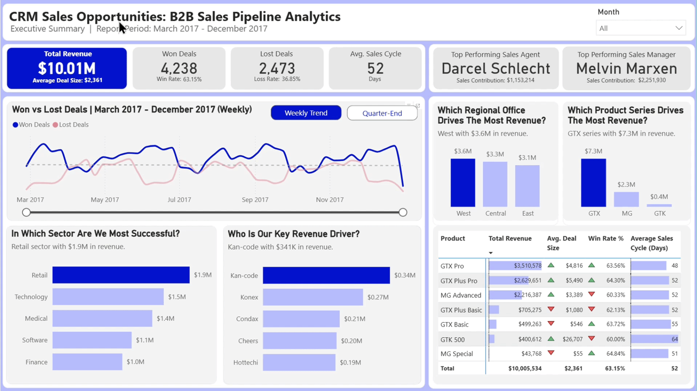
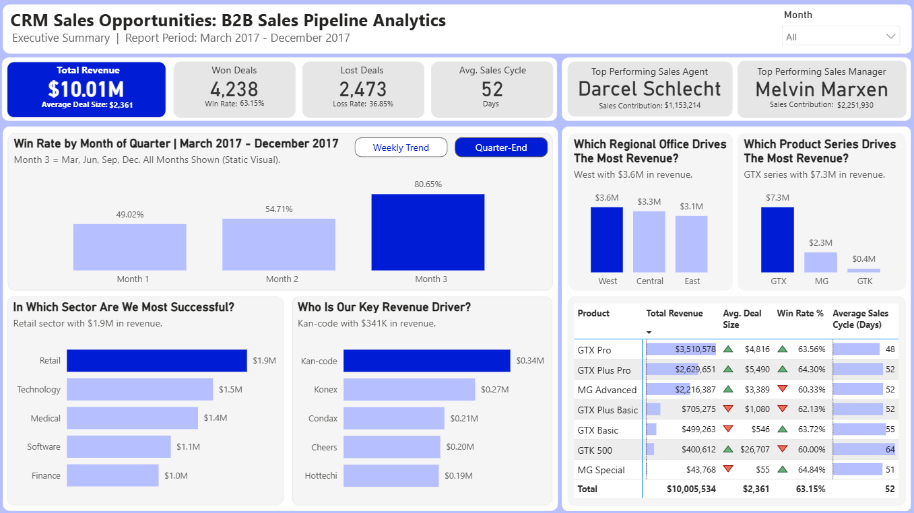
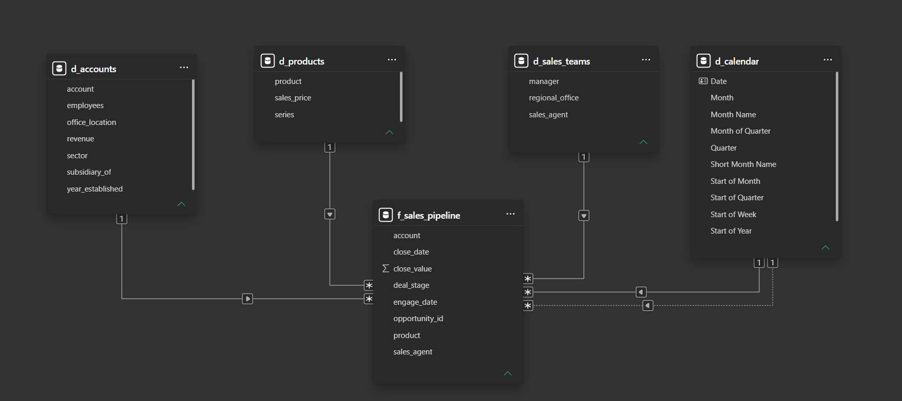

# CRM Sales Opportunities: B2B Sales Pipeline Analytics (Power BI)

A one-page Power BI dashboard that shows MavenTech's sales managers which agents, products, and offices drive revenue, and when in each quarter deals are actually won.



**View interactive dashboard (best viewed on desktop):** [Open in Power BI](https://app.powerbi.com/view?r=eyJrIjoiZTE2MzNmYWItODIyYi00ODVkLWFlZGItMWRiOTg0MDJjNmY5IiwidCI6ImUwYTA4ZjRjLWI0YTctNGQxMy1iY2U2LTcyMWRhMWI0ZWQ0OSIsImMiOjEwfQ%3D%3D)

## Overview

**Problem:** MavenTech's sales managers couldn't track which agents and products were winning or lagging because their CRM had no reporting, so they couldn't act early.

**Approach:** I cleaned the data in Power Query, modeled it in Power BI, and built a dashboard tracking win rate, deal size, and sales cycle by agent and product.

**Data:** 8,800 sales opportunities from the CRM of MavenTech, a fictional company that sells computer hardware to large businesses. The data covers 85 accounts, 7 products, and 35 sales agents (30 with deals) under 6 managers in 3 regional offices. Deals closed between March 1 and December 31, 2017: 4,238 won, 2,473 lost, and 2,089 still open (1,589 Engaging and 500 Prospecting).

Data quality fixes in Power Query:

- 1,425 open opportunities had no account, so they are labeled "Unknown Account". None of them are won or lost deals, so revenue and win rate are not affected.
- The product name "GTXPro" in the pipeline table was standardized to "GTX Pro" so it matches the products table.
- The sector label "technolgy" was corrected to "technology", and sector labels were capitalized for display.
- Five unused extra columns (Column9 to Column13) were removed from the pipeline table.

## Business Questions

1. How much revenue did MavenTech win, and what are its win rate, average deal size, and average sales cycle?
2. How do won and lost deals move week to week?
3. When in the quarter are deals most likely to be won?
4. Which regional office and which product series drive the most revenue?
5. In which sector is MavenTech most successful, and which accounts drive the most revenue?
6. Who are the top-performing sales agent and sales manager?
7. How do the products compare on revenue, deal size, win rate, and sales cycle?

## Key Insights

**Insight 1: Win Rate Climbs Through Every Quarter (Reference: Quarter-End Pattern view)**



Win rate rises from 49.0% in the first month of each quarter to 54.7% in the second month and 80.7% in the third. The pattern repeats in every full quarter: from 48.6% in April to 82.8% in June, from 49.1% in July to 79.2% in September, and from 49.3% in October to 78.5% in December. Quarterly totals hide this swing, since Q2 to Q4 all sit between 60% and 62%. Won deals close at about 99% to 100% of list price every month, so discounting does not explain the spike. The sales cycle follows the same rhythm: deals won in the first month of a quarter closed in about 6 days on average, compared with 57 to 67 days in the other months, as if longer-running deals are pushed to close before quarter-end. The most likely driver is a quarter-end push tied to quarterly sales quotas, which is a hypothesis to confirm with the sales team.

**Insight 2: The GTX Series Brings In Nearly Three Quarters of Revenue (Reference: Product Series chart)**

GTX products generated $7.34 million of the $10.01 million in total revenue, or 73.4%. GTX Pro alone brought in $3.51 million (35.1%). The MG series added $2.26 million and the GTK series $0.40 million. Revenue depends heavily on one product line.

**Insight 3: The Highest-Value Product Is the Hardest to Close (Reference: Products matrix)**

GTK 500 has the highest average deal size at $26,707, about 11 times the company average of $2,361. It also has the lowest win rate (60.00%) and the longest sales cycle (64 days), and it closed only 15 deals for $400,612 in revenue.

## Recommendations

**Recommendation 1: Spread Wins Across the Quarter**

Since win rate jumps from about 49% to 81% within each quarter, sales managers should split quarterly quotas into monthly targets and hold pipeline reviews in the first month of each quarter. Marking deals as Lost as soon as they are lost would also keep the pipeline accurate. This should make monthly revenue and workload steadier and forecasts more reliable. With monthly targets, wins are spread across all three months instead of piling up in the last one, so contracts, delivery, and billing no longer bunch up at quarter-end. Early-quarter reviews also show whether a slow first month is a real problem or just the usual cycle. This makes forecasts easier to trust. Before changing targets, confirm the quarter-end push with the sales team.

**Recommendation 2: Find What Slows Down GTK 500 Deals**

GTK 500 earns the most per deal but takes the longest to close and wins the least often. Sales managers should review lost and long-running GTK 500 deals to find where they stall, then coach the team on what worked in the deals that closed. Since one GTK 500 deal is worth about 11 average deals, even a few more wins would add meaningful revenue.

**Suggested priority:**
Start with Recommendation 1, since the quarter-end pattern affects every product in every quarter. Then work on Recommendation 2, which targets one high-value product.

## Data Model



A star schema with one fact table (f_sales_pipeline, one row per opportunity) and four dimension tables (d_accounts, d_products, d_sales_teams, d_calendar). The calendar connects to close_date through an active relationship and to engage_date through an inactive one. All measures are stored in a separate _Measures table.

## Key DAX Measures

**Win rate:** won deals divided by closed deals (won plus lost). Open deals are excluded because they have no outcome yet.

```dax
Win Rate % (Own Formula) =
VAR _Win =
    CALCULATE ( COUNTROWS ( f_sales_pipeline ), f_sales_pipeline[deal_stage] = "Won" )
VAR _Lost =
    CALCULATE ( COUNTROWS ( f_sales_pipeline ), f_sales_pipeline[deal_stage] = "Lost" )
RETURN
    DIVIDE ( _Win, _Win + _Lost, 0 )
```

**Deal size flag:** compares each product's average deal size with the company average and returns 1 (above) or -1 (below). The product matrix icons are based on this flag.

```dax
Deal Size Flag =
VAR _ProductAvg = [Average Deal Size]
VAR _OverAllAvg =
    CALCULATE ( [Average Deal Size], ALL ( d_products ) )
RETURN
    IF ( _ProductAvg >= _OverAllAvg, 1, -1 )
```

**Dynamic subtitle:** names the top regional office and its revenue, and updates when the Month slicer changes.

```dax
Top Region Subtitle =
VAR _TopItems =
    TOPN ( 1, ALLSELECTED ( d_sales_teams[regional_office] ), [Total Revenue (CALCULATE)], DESC )
VAR _TopName =
    CONCATENATEX ( _TopItems, d_sales_teams[regional_office], ", " )
VAR _TopRevenue =
    MAXX ( _TopItems, [Total Revenue (CALCULATE)] )
VAR _RevenueText =
    IF (
        _TopRevenue >= 1000000,
        FORMAT ( _TopRevenue / 1000000, "$0.0" ) & "M",
        FORMAT ( _TopRevenue / 1000, "$0" ) & "K"
    )
RETURN
    IF (
        ISBLANK ( _TopRevenue ),
        "No won deals in this period.",
        _TopName & " region with " & _RevenueText & " in revenue."
    )
```

## Tools & Skills

- **Power BI Desktop**: star schema modeling, active and inactive relationships, bookmarks and buttons, rule-based icon formatting, DAX-driven dynamic subtitles and bar/column colors, edit interactions
- **Power Query**: null handling, text standardization, column cleanup, calendar columns (including Month of Quarter)
- **DAX**: CALCULATE, ALL, ALLSELECTED, TOPN, MAXX, CONCATENATEX, DIVIDE, COUNTROWS, AVERAGEX, FILTER, DATEDIFF, SELECTEDVALUE, FORMAT, SWITCH, ISFILTERED, variables (VAR and RETURN)
- **Git & GitHub**: version control
- **Business analysis & data storytelling**: turning KPIs and patterns into insights and recommendations

## Files

- [`assets/dashboard_weekly_trend.png`](assets/dashboard_weekly_trend.png) - dashboard, Weekly Trend view
- [`assets/dashboard_quarter_end.png`](assets/dashboard_quarter_end.png) - dashboard, Quarter-End Pattern view
- [`assets/data_model.png`](assets/data_model.png) - the star schema data model
- [`assets/dashboard_walkthrough.gif`](assets/dashboard_walkthrough.gif) - dashboard walkthrough (sped up)

## Data Source

This project uses the CRM Sales Opportunities dataset from the Maven Analytics Data Playground:
https://mavenanalytics.io/data-playground/crm-sales-opportunities

The dataset page lists the license as Public Domain and data.world as the source. MavenTech is a fictional company.

## Version History

- **v1 (April 2026):** Original capstone project for my Power BI Data Analyst training.
- **v2 (October 2026):** Revised after a self-review:
  - Added a Quarter-End Pattern view (win rate by month of quarter), switched with bookmark buttons on the main chart.
  - Replaced the default icon rules with above/below-average rules for Avg. Deal Size and Win Rate %.
  - Added data labels, plus DAX-driven dynamic subtitles and bar/column colors that update with the Month slicer.
  - Retitled the regional office chart to "Which Regional Office Drives The Most Revenue?" so the title matches its metric.
  - Corrected the report period to March 2017 to December 2017, based on the first closed deal (March 1, 2017).
  - Fixed the "technolgy" sector label in Power Query.
  - Removed unused measures and draft pages.
- **v2.1 (October 2026):** Bug fixes and live version:
  - Replaced static KPI text (Average Deal Size, Win Rate, Loss Rate, and both Sales Contribution values) with dynamic values that update with the Month slicer.
  - Set the Total Revenue card to millions with 2 decimals.
  - Made the main chart title follow the Month slicer.
  - Fixed bar and column colors that showed differently in the Power BI service by removing leftover manual colors.
  - Adjusted the product matrix spacing so it fits without scrollbars on the web.
  - Published the dashboard to the web and added a GIF walkthrough.
